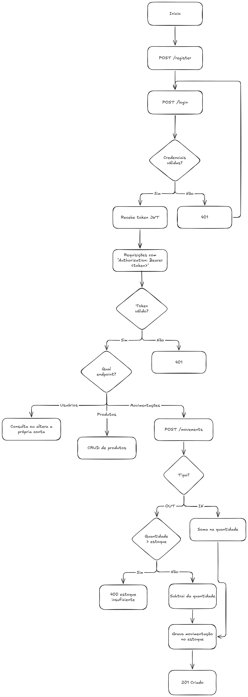

# Controle de Estoque

Este projeto é uma API feita em Flask para controlar o estoque de uma loja. O usuário se cadastra, faz login e recebe um token. Com o token ele pode cadastrar produtos e registrar entradas e saídas do estoque. A API não deixa o estoque ficar negativo.

Link do repositório: https://github.com/Lucas-Steffen/lp-flask-python

## Módulos

O projeto tem 5 módulos:

1. **Autenticação** (`routes/auth.py` e `jwt.py`)
2. **Usuários** (`routes/user.py` e `model/user.py`)
3. **Produtos** (`routes/product.py` e `model/product.py`)
4. **Movimentações** (`routes/movement.py` e `model/movement.py`)
5. **Banco de dados e configuração** (`app.py`, `model/__init__.py` e `settings.toml`)

## Descrição dos módulos

### 1. Autenticação
Tem a rota de cadastro (`POST /register`) e a de login (`POST /login`). No cadastro a senha é salva com hash, não em texto puro. No login, se o usuário e a senha estiverem certos, a API devolve um token JWT que vale por 1 hora. As outras rotas precisam desse token no header `Authorization: Bearer <token>`.

### 2. Usuários
Rotas para listar usuários (`GET /users`), buscar um (`GET /users/<id>`), alterar (`PUT /users/<id>`) e remover (`DELETE /users/<id>`). Cada usuário só pode alterar ou remover a própria conta. Se o usuário já fez alguma movimentação, ele não pode ser removido.

### 3. Produtos
Rotas para cadastrar, listar, buscar, alterar e remover produtos. O produto tem nome, sku (que não pode repetir), preço, quantidade e quantidade mínima. A rota `GET /products/low-stock` lista os produtos que estão com a quantidade menor ou igual à mínima. Produto que já tem movimentação não pode ser removido.

### 4. Movimentações
Rotas para registrar (`POST /movements`) e listar (`GET /movements`) as movimentações. Cada movimentação é uma entrada (`IN`) ou uma saída (`OUT`) de um produto. Se a saída for maior que a quantidade que tem no estoque, a API devolve erro 400 ("estoque insuficiente"). Assim o estoque nunca fica negativo.

### 5. Banco de dados e configuração
O `app.py` cria o app Flask e o banco. O banco é o SQLite (arquivo `instance/app.db`) e as tabelas são criadas sozinhas quando o projeto roda. As configurações (como a chave do token) são lidas com o Dynaconf.

## Fluxograma

Fluxograma feito no Excalidraw. [Clique aqui para abrir a imagem em tamanho original](docs/fluxograma.png).

[](docs/fluxograma.png)

[Arquivo excalidraw do fluxo](docs/fluxograma_lp.excalidraw)

## Como rodar o projeto

Criar o ambiente virtual:

`python -m venv .venv`

Ativar o ambiente:

`.venv/Scripts/activate.bat` (CMD)

ou

`.venv/Scripts/Activate.ps1` (PowerShell)

Instalar as dependências:

`pip install -r requirements.txt`

Criar um arquivo chamado `.secrets.toml` na pasta principal, com este conteúdo:

```
SECRET_KEY = "uma-chave-qualquer"
ALGORITHM = "HS256"
```

Rodar a aplicação:

`flask --app app run --debug`

A API fica em `http://127.0.0.1:5000`.

## Como testar

Primeiro cadastrar um usuário:

```
curl.exe -X POST http://127.0.0.1:5000/register -H "Content-Type: application/json" -d '{\"username\":\"lucas\",\"email\":\"l@l.com\",\"password\":\"123\"}'
```

Depois fazer login (ele devolve o token):

```
curl.exe -X POST http://127.0.0.1:5000/login -H "Content-Type: application/json" -d '{\"username\":\"lucas\",\"password\":\"123\"}'
```

Por fim usar o token nas outras rotas:

```
curl.exe http://127.0.0.1:5000/products -H "Authorization: Bearer <token>"
```

## Importar os endpoints no ApiDog

Caso queira importar os endpoints no ApiDog, pode usar o arquivo [export_apidog_openapi.json](export_apidog_openapi.json) para fazer o import.

## Tecnologias usadas

Python, Flask, Flask-SQLAlchemy, SQLite, Dynaconf e python-jose.
